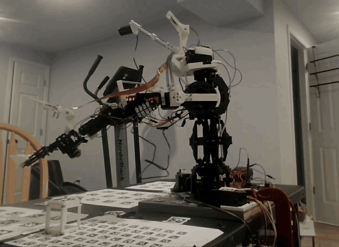
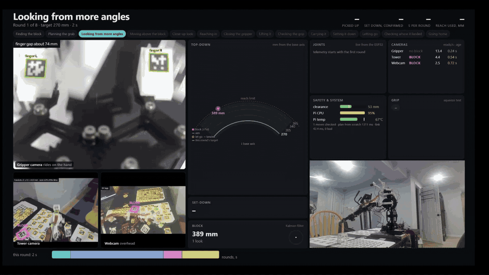
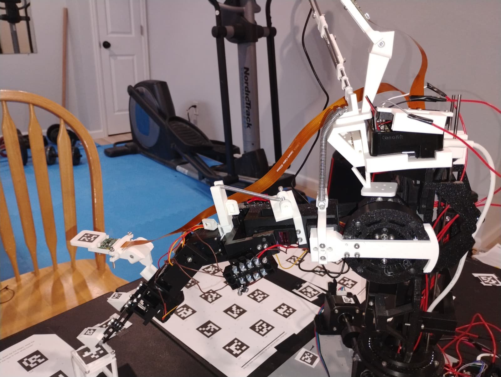

# Camera-Guided Robot Arm

[](../../actions/workflows/tests.yml)

A 5-axis arm I designed, printed and wired, that finds a block on the table, picks it up, carries it somewhere new
and sets it down, round after round with nobody touching it. It has no joint encoders: hobby servos don't report
where they are, so the arm watches itself and the block with three cameras and AprilTags, and corrects from what it
sees.

[](docs/images/arm_round.mp4)

*One grab and place at 2× speed (the clip runs 26 s in real time; the best demo averaged 28.2 s per round). Click for the
[real-speed video](docs/images/arm_round.mp4).*

[](docs/images/demo.mp4)

*The same kind of round from the arm's side, on its live dashboard: what each camera sees, the block's estimated
position, the joints, and each step of the grab as it happens (2× speed, [real-speed video](docs/images/demo.mp4)).*

## Results

| | |
|---|---|
| Best demo run | **8 / 8** rounds picked up, carried and set down, confirmed by camera |
| Round time (find → grab → carry → set down) | **28.2 s** average, from 107 s when first timed |
| Set-down accuracy | **6.2 mm** average from the aimed spot (worst 12.6 mm), from 13–25 mm before the fixes |
| Reach covered by the demo | blocks picked up 284–367 mm from the base axis |
| Grasp planning, from scratch | 85 s → **3.7 s** (caching + numba); on the Pi, ~1.4 s from a precomputed table |
| World model self-test (synthetic, 0.4 px noise) | hand placed to **0.2 mm** median |

The best run's raw data is in [`results/2026-10-23_best_show`](results/2026-10-23_best_show); the numbers above
come from `python tools/show_report.py results/2026-10-23_best_show/show/20261023_020800.json`. Earlier runs the
same night went 7/8, 7/8 and 4/8; the 4/8 was a set-down that pushed the block out of reach, which led to the
set-down fixes in [decision 5](docs/decisions/05-set-down.md).

## How it works

```
 ┌───────────────────────── Raspberry Pi 5 ─────────────────────────┐        ┌──────── ESP32 ────────┐
 │ dual_cam_stream.py   three cameras, AprilTag detection, frames   │        │ 5 servos + stepper    │
 │        │             with capture timestamps                     │  UART  │ clock-timed moves     │
 │ arm.py + armlab/ ◄───┘                                           │◄──────►│ checksummed commands  │
 │   world model · block filter · grasp planner · safety checks     │ / WiFi │ joint limits, telemetry│
 │   demo loop (show) · live dashboard (:8090)                      │        └───────────────────────┘
 └──────────────────────────────────────────────────────────────────┘
       laptop: tools/big_solve.py (world model), plan table, safety map, offline replays
```

1. **Find** the block with the tower camera and webcam (they turn with the base), from a search pose that keeps
   the arm out of their view. Several looks are fused in a small Kalman filter.
2. **Plan** a hover, a straight way in, a grasp square to a face, and a way out, from a precomputed plan table
   re-solved for this block. Every pose is checked against the safety map and an exact table model.
3. **Go to the hover and look closely** with the gripper camera, re-measure the base angle from table tags, and
   re-plan from what it sees.
4. **Grab and confirm**: a squeeze test (an empty hand closes further) and a camera watching the block rise.
5. **Carry and set down** at the next distance on the demo's ladder (270 → 365 mm and back), release gently, lift
   straight up, and look again to see where it landed.

Everything about the arm (link lengths, joint gearing, camera poses, every tag's position, each joint's slack)
comes from a **world model** solved from survey data by bundle adjustment, not from a tape measure.

## The hardware

<p align="center">
  
</p>

I designed the arm in Fusion 360 and printed it. A NEMA 17 stepper turns the base through a 40:1 worm gear, and
the whole tower turns with it: the arm, the Raspberry Pi 5 and two of the cameras. The shoulder's servo drives
through a printed planetary gearbox with a spring counterbalance, the elbow, wrist and wrist rotate are servos,
and the gripper keeps its fingers parallel with a geared linkage. The tower and shoulder turn on ball-bearing races
I printed myself. Each part, and why it's built that way, is in [`hardware/`](hardware/README.md).

## Engineering decisions

The interesting part of this project was finding out why things failed. Each write-up says what went wrong, how it
was measured, and what changed:

1. [**A world model solved from the cameras**](docs/decisions/01-world-model.md): bundle adjustment over a
   623-pose survey; it found a wrist convention two solves disagreed on and a grip centre 10 mm off.
2. [**Every move is checked, in three layers**](docs/decisions/02-safety.md): safety map, an exact table check
   that was 134 ms a call until a lower-bound trick, and firmware limits plus checksummed commands (after motor noise
   once drove the shoulder into the table).
3. [**The base: a worm gear that doesn't land where you tell it**](docs/decisions/03-base.md): a step count
   starved by servo writes (fixed by giving the stepper its own CPU core), a camera-closed loop, and then using that
   loop only where it pays off.
4. [**Grasp planning from 85 s to under 4**](docs/decisions/04-grasp-planning.md): why straight ways in beat
   joint space (no joint-space grab ever held), caching, numba, a precomputed plan table.
5. [**Setting the block down where you meant to**](docs/decisions/05-set-down.md): an offline replay tool
   and four separate causes of outward drift.
6. [**Making a round fast: 107 s → 28 s**](docs/decisions/06-speed.md): tracing every phase, and what was
   deliberately left slow.
7. [**Seeing the block**](docs/decisions/07-seeing-the-block.md): fusing looks, choosing where to look from,
   stale frames.

The firmware has its own [changelog](firmware/esp32_arm/CHANGELOG.md): every version fixed something the arm did.

## Repository layout

```
firmware/esp32_arm/   ESP32 firmware (Arduino): servos, worm-gear base, cable protocol, web page, game controller
pi/
  arm.py                entry point:  python3 arm.py <mode>
  armlab/               the control program
    grasp.py, fastik.py   grasp planner and its numba-compiled solver
    world.py, cube.py     world model (kinematics + cameras), block location and filter
    safety.py, tablecheck.py   safety map and exact table check
    motion.py, baseloop.py     checked moves, camera-closed base
    link.py               checked UART/WiFi link to the ESP32
    live.py               live dashboard for the demo
    modes/                grasp, show (demo loop), survey, basehome, touch, ...
  dual_cam_stream.py    camera + AprilTag service
  calibrate_cam.py      lens calibration (ChArUco)
  tests/                pytest, run by GitHub Actions on every push
tools/                laptop side: big_solve (world model), plan table, safety map, show reports, offline replays
sim/                  MuJoCo model of the arm
hardware/             the arm's design, part by part, its CAD (STEP), and the MuJoCo parts the safety checks use
docs/                 decision write-ups, images
results/              raw data from the best demo run
```

## Running it

Hardware: Raspberry Pi 5 with two Pi cameras and a USB webcam, an ESP32 driving five hobby servos and a NEMA 17
stepper on a 40:1 worm, AprilTag 36h11 tags on the arm, table and block.

1. **Firmware:** copy `firmware/esp32_arm/secrets.example.h` to `secrets.h` and fill in your WiFi, then flash it
   with the Arduino IDE (libraries: ESP32Servo, FastAccelStepper).
2. **Pi:** `sudo apt install python3-picamera2 python3-opencv python3-serial`, `pip install numpy numba flask`,
   then run `pi/dual_cam_stream.py` (I run it as a systemd service).
3. **World model:** `python3 arm.py survey`, then on the laptop `python tools/big_solve.py <survey folder>`, and
   copy `world.json` back to `~/arm_data`. Build the plan table with `tools/build_plan_table.py`.
4. **Use it:**
   ```
   python3 arm.py status                      # check the ESP32, cameras and safety map; no movement
   python3 arm.py basehome --world-only       # zero the base on the table tags
   python3 arm.py grasp --grab                # find the block and pick it up
   # the demo loop, as recorded:
   python3 arm.py show --rounds 8 --stay-up --grasp-depth 10 --table-margin 15 --hover-clear 0 --hunt back --hand-rel --looks 1 --pan-overlap
   ```
   While `grasp` or `show` runs, the dashboard is at `http://<pi>:8090`.

## Testing

`cd pi && python -m pytest` runs 85 tests with no hardware: kinematics, the planner (including the compiled solver
against the Python one), the safety checks, the block filter, the set-down logic and the dashboard. Many of them
are regression tests named after a specific failure on the arm. GitHub Actions runs them and a lint pass on every
push.

Offline, `tools/replay_grasp.py` and `tools/replay_place.py` re-run the planner on recorded runs, so a change can
be checked against every past grab and set-down before it goes near the arm.

## How it was built

I built the hardware, ran every experiment on the arm, and made the calls on what to try next. I wrote the code
with the help of Claude: we iterated on the code together from my direction and the arm's data, and I reviewed,
tested and ran all of it.

## What's next

- Feed the arm-state Kalman filter (`armlab/track.py`) into set-down aiming
- Fold the demo's command-line flags into `show`'s defaults
- A full CAD assembly, and a MuJoCo model that looks like the real arm
- A second object type, and picking from clutter

## License

MIT
