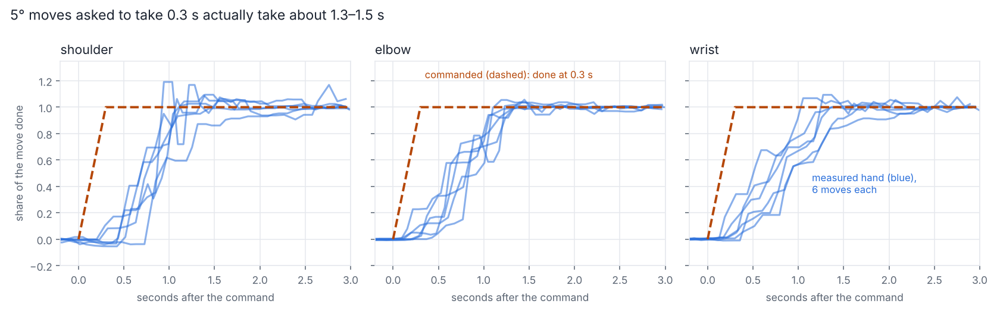

# 6. Making a round fast: 107 s → 28 s

A demo round is: find the block, plan, go to a hover above it, take a close look, go in, close the gripper, check the
grip, lift, carry, set down, let go, and look again. The first timed rounds took **107 s**. In the best show they
averaged **28.2 s**.

## It started in the firmware

The first thing I measured (`pi/arm_probe.py`, with the tower camera tracking the hand) was simple moves, and they
were far slower than asked: a 5° move asked to take 0.3 s took 1.3–1.5 s. The firmware moved each joint a fixed
amount per loop, and the loop ran slower than it was meant to. Firmware 4.7 switched to moves timed by the clock and
shaped to start and stop smoothly. The same 0.3 s move then took 0.38 s instead of 1.23 s, and the shoulder came to
rest in 0.70 s instead of 1.38 s.

## Measure where the time goes

Guessing didn't work, so each grab records how long each phase took, and later a full trace (`pi/armlab/trace.py`):
every arm move, base turn, gripper move, camera look, plan and wait, with start and end times, plus the Pi's CPU load
and temperature. `tools/timeline.py` splits each phase into moving, looking, computing and waiting, including time
when nothing was recorded at all. Most of the wins below were invisible until the trace showed them.

## Where it went

| Fix | Time saved |
|---|---|
| Plan from a precomputed table instead of from scratch ([planning](04-grasp-planning.md)) | ~14 s a round |
| Only check the base angle with the cameras right before going in ([base](03-base.md)) | ~9.5 s a round |
| Send the ~10 poses near the block as one smooth move. Each used to be its own move, waiting until every joint was within 0.3° before the next | most of the ~34 s a round spent beside the block |
| Plan the carry while lifting and checking the grip, instead of after | 2–12 s down to ~0.2 s |
| Start turning the base toward the block while the plan finishes | the move to the hover has 25–45° less turning left |
| After the close look, re-plan starting from the first plan instead of planning again from scratch | ~11 s |
| After a miss, stay up where a camera can see the block instead of going home where none can | 10–25 s per miss |
| Move the arm while the base turns, after checking each combination is safe (`--pan-overlap`) | ~3 s a round |
| Faster moves in open space (45°/s), 0.3 s gripper moves, shorter waits to settle | ~5 s |

## What I didn't speed up

The moves beside the block stay slow: 16°/s in the show and 8°/s by default. That's where a fast move costs a grab.
I also kept the squeeze test that checks the grip. The spacing of the finger tags *almost* tells a full hand from an
empty one, but on the Pi's own readings the two ranges overlap, so it isn't enough on its own.

## The Pi is the limit now

During a show the Pi 5 averages about 88% busy and peaks around 76 °C. The camera server alone can use about 335%
of the 400% four cores give, because three cameras are running AprilTag detection. Each camera's detection rate is
capped (the gripper camera, which guides the grab, gets the most), and during the search, when the gripper camera
only sees table, the arm program pauses its detection.
