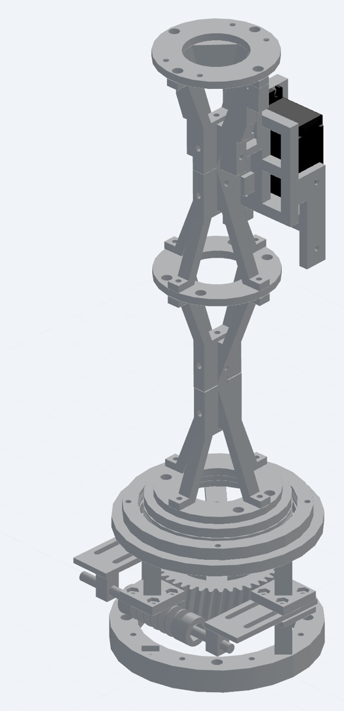
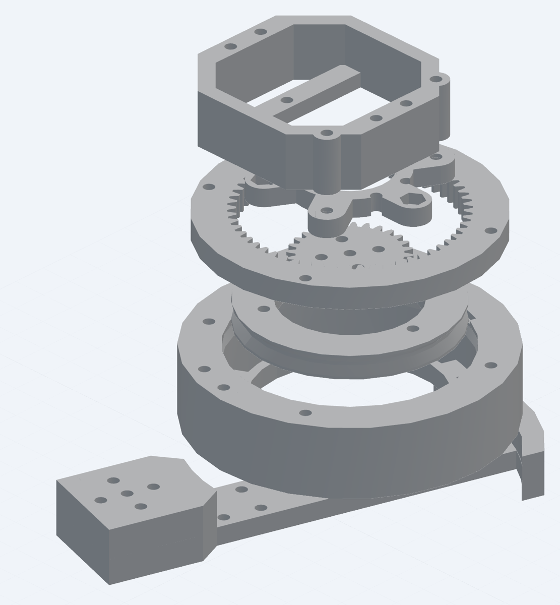
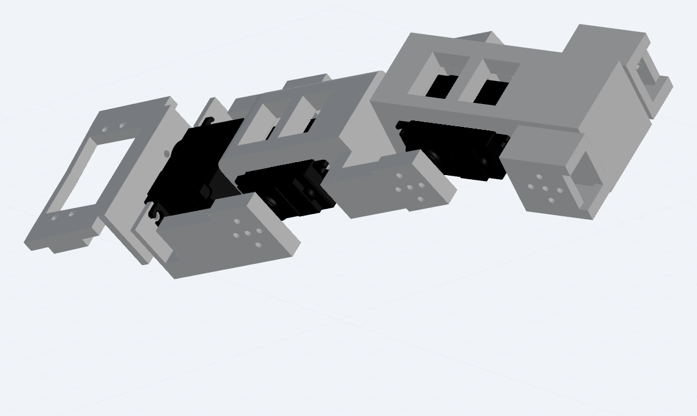
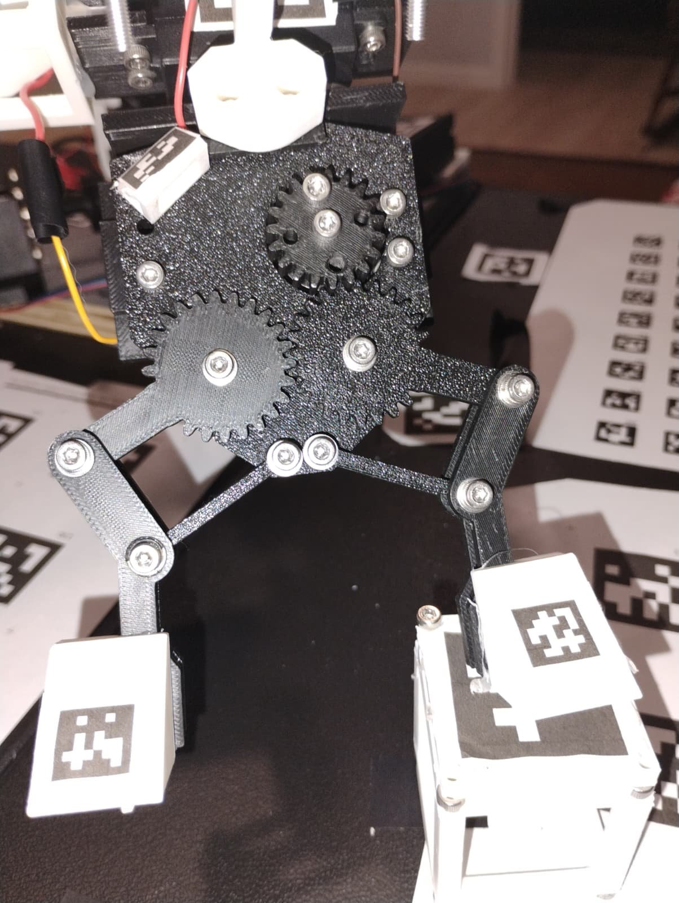
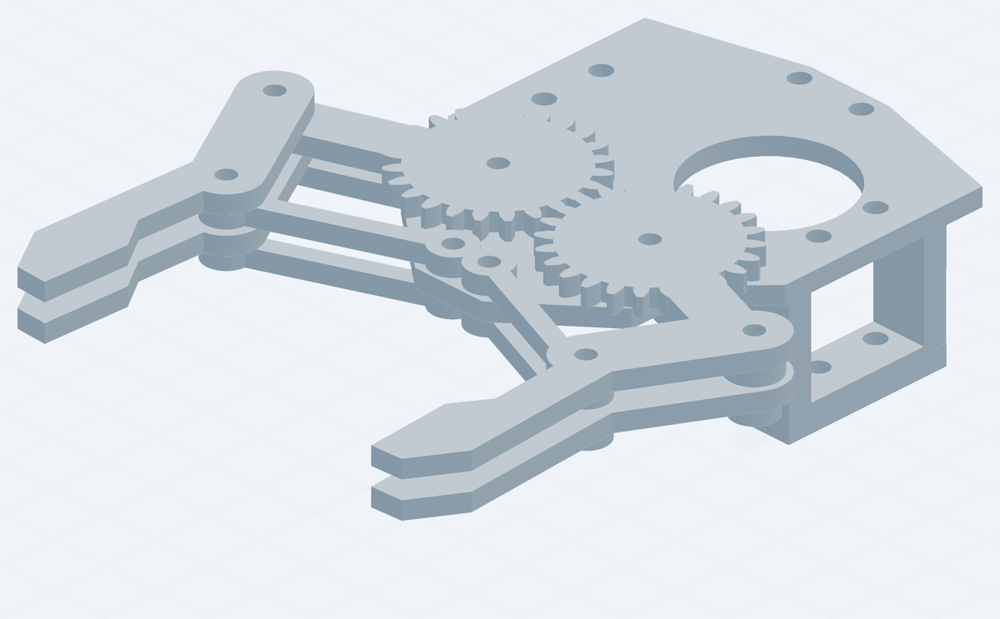

# The arm's hardware

I designed the arm in Fusion 360 and printed it on a Bambu A1. It has a stepper-driven base, five hobby servos
(shoulder, elbow, wrist, wrist rotate, gripper) and three cameras. The structure, the gearbox and the bearing races
are printed.

| Part | Actuator | Notes |
|---|---|---|
| Base | NEMA 17 stepper, 40:1 worm gear | turns the whole tower; holds position with the power off |
| Shoulder | MG996R servo behind a printed planetary gearbox (~2:1) | spring counterbalance |
| Elbow | MG996R, direct drive | |
| Wrist | MG996R | |
| Wrist rotate | MG996R | about half a turn of real travel, capped to 0–112 |
| Gripper | servo through two meshed gears | parallel fingers, 65 mm open |

## Base

The base turns on a NEMA 17 stepper (0.9° steps) through a 40:1 worm gear, so one motor turn moves the arm 9°. I
went with a worm for precision: stacked on the stepper's own small steps, the 40:1 reduction means a single step
(with the TB6600 driver at 8 microsteps) turns the base less than 0.003°, or 355.6 steps per degree. A worm also
can't be turned backwards by the load, so the arm stays where it is with the power off, and the ESP32 remembers the
step count in flash across power cuts.

The fixed part of the base is bolted to 19 mm plywood, which is clamped to the table.

How the base's play was handled in software is in [decision 3](../docs/decisions/03-base.md).

## Tower

Everything above the base turns together: the arm, the Raspberry Pi 5 (in a dual-fan case), and two of the
cameras. It rides on a printed ball-bearing race filled with 3/16" steel balls. Two vertical rods run up through the
middle, and the wiring runs through a hole in the centre so the tower can turn without winding it up.

The tower camera (a Pi camera) sits about 215 mm above the shoulder hinge, in the plane of the arm. The webcam is on
a boom clamped to the rods. Putting the cameras on the part that turns was deliberate. Because they move with the
arm, where the arm appears to them doesn't depend on the base angle at all, so there's one less thing to estimate
when they watch the arm. Their job becomes working out where things are in the world, like the block and the table
tags, and those same table tags are how the base angle gets measured.

## Shoulder

The shoulder lifts the whole arm, so it carries the most load. Its MG996R drives through a printed planetary gearbox
for more strength, which replaced a 16-tooth/32-tooth spur pair. Gearing down costs range of motion, but the shoulder
doesn't need a huge range, so trading some of it for torque is a good deal. The gearbox measures about 2:1, and the
world model solves the exact gearing from survey data anyway. An extension spring counterbalances the arm, so the
servo only carries about half its weight. The shoulder pivots in printed supports with their own ball races (5/32"
balls).

## Elbow and wrist

The upper arm is 109 mm and the forearm 100 mm (pivot to pivot, from the CAD). Both the elbow and the wrist are
MG996R servos driving their joints directly. The wrist is limited to where the gripper camera would hit the elbow
spring's mount.

## Wrist rotate

Another MG996R turns the whole hand about the forearm's axis. It only has about half a turn of real travel, and past
a certain point the hand dug into itself, so the firmware caps it at 0–112. That limit is one of the things the
grasp planner has to work around ([decision 4](../docs/decisions/04-grasp-planning.md)).

## Gripper

A servo turns two meshed 24-tooth gears, and linkages keep the two fingers parallel as they open and close. The
fingers open to 65 mm around a 39.7 mm block and reach 84 mm in front of the gear centres. The gripper camera rides
on the hand, looking down past the fingers, and each finger carries an AprilTag so the cameras can see how far it's
open.

| Real | CAD |
|---|---|
|  |  |

## Tags on the arm

The cameras find the arm by AprilTags on the links, the tower and the table. Tags stuck flat on a round or narrow
part are often seen almost edge-on, so some sit on printed wedges that tilt them toward the cameras.

## Electronics

An ESP32 drives the servos and the stepper and talks to the Pi over a serial cable with checksummed commands
([decision 2](../docs/decisions/02-safety.md)). The servos run on their own 6 V supply through a screw-terminal hub
with a star ground, and the stepper driver runs on 12 V. Keeping the serial wires away from the servo wires
mattered: running them together made the wrist rotate twitch whenever the base turned.

## Files

| Folder | What's in it |
|---|---|
| `cad/arm/` | Fusion 360 STEP exports: `tower.step` (with the worm drive), `shoulder_gearbox.step`, `arm_links.step` (upper arm, forearm and wrist), `gripper.step` |
| `cad/rigid_parts/` | the arm's CAD split into rigid parts (tower, upper arm, forearm, wrist, hand, base and plywood) as a MuJoCo model. `tools/register_cad.py` places these parts in the solved world model, and the safety map and exact table check are built from them |
